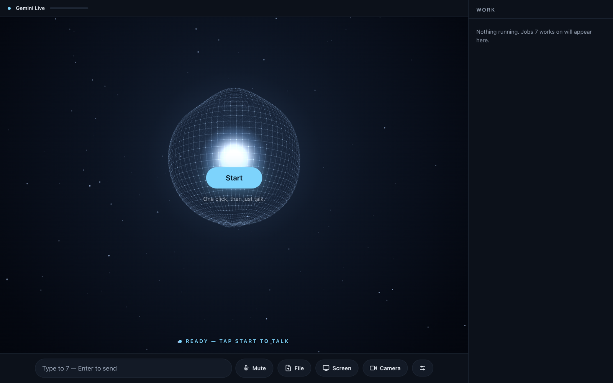
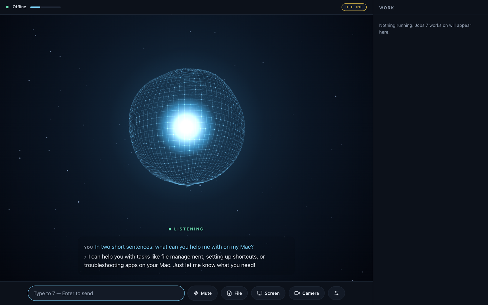

# 7 Live — a voice-first, local-first personal agent

7 Live is a desktop assistant for macOS that you talk to. It hears you through Gemini Live, answers by voice
in about one second, and does real work on your Mac with 63 tools. Every action passes through one safety
core (Sentinel). Anything risky needs your own spoken "yes" or a click. The model can never approve itself.
Long jobs go to Hermes in the background, and 7 tells you the result when it is ready.

It understands English, Punjabi (Gurmukhi and romanised) and Hindi.





## What it does

**Voice and conversation**
- Always-listening voice chat (Gemini Live). Interrupt it while it speaks. Live captions.
- Eight voices (Charon by default), switchable mid-conversation. A text box for typing.
- Reconnects on its own with session resumption, and compresses long conversations.
- **Offline mode:** with no internet it switches to local speech-to-text (Whisper, or wav2vec2 for
  Punjabi), a local model and the macOS voice.

**Work in the background**
- `ask_hermes` hands a task to [Hermes](https://github.com/NousResearch/hermes-agent) and returns at once.
  When Hermes finishes, 7 waits for a quiet moment and speaks the result. A timeline shows running and
  finished jobs. Hermes is optional: install it separately if you want this.

**Mac control** (reversible actions can be undone)
- Volume, brightness, windows, music, clipboard, typing and keyboard shortcuts.
- Open and quit apps, open websites, search.
- Files: find, move, copy, rename, trash, organise a folder (dry run first).
- Reminders and macOS Calendar (add, list, undo).

**Documents and information**
- Create, read and edit Word, Excel and PowerPoint files, and export to PDF (Gurmukhi included).
- Daily briefing from real sources only: calendar, reminders, weather and BBC headlines. A source that
  fails is named as unavailable, never invented.
- Live news shown on 7's own screen.
- Weather, distances between places, web search and fetch, circuit wiring for Arduino/ESP32.

**Vision and files**
- Share your screen and 7 can see it (frames are sent only while sharing is on).
- Drop a file (image, text, PDF, Word, up to 10 MB) and talk about it.

**Older Agent 7 abilities, now available inside 7 Live**
- A team of nine specialists (`team_ask`, `team_status`). Specialists advise; Sentinel decides.
- Memory and learning from failures (`recall`, `dream`, `failure_report`), planning before acting
  (`foresee`), approved self-improvement proposals (`evolve`), and voting among specialists (`board`).
- Draft-first pages: nothing is written to disk until you approve it (`page_draft`, `page_approve`).
- Static code review (`code_review`) and read-only binary inspection (`reverse_inspect`, never runs the
  sample).
- Prompt-injection screening of web content (`guard_scan`).

## Safety

- **Sentinel** checks every tool call: risk level, the Rule-of-Two veto (untrusted input plus sensitive
  data plus an outside effect is refused automatically), the approval gate, and a hash-chained audit log.
- **Approvals:** medium- and high-risk actions ask you out loud. Only your own "yes / haan" or a click
  approves; silence or a timeout means no.
- **Undo first:** reversible actions run at once and go on an undo stack.
- **Loopback only:** the server binds to 127.0.0.1, checks the page origin and opens no LAN ports.
- **Egress allow-list** for web tools, with SSRF protection.
- Hermes is only ever called in guarded mode. Its YOLO, one-shot and hook-accepting flags are never used.
- Dangerous file operations are refused outright (for example, trashing the home folder or a top-level
  folder).

## Quick start

Requirements: macOS on Apple Silicon, Python 3.12, and `ffmpeg` (`brew install ffmpeg`).

```bash
git clone https://github.com/gurpreetsingh5523-source/seven.git
cd seven
python3.12 -m venv .venv && source .venv/bin/activate
pip install -r requirements.txt
python -m live7            # open http://127.0.0.1:7879 and press Start
```

The first time you press **Start**, the browser asks for the microphone. Allow it.

### Online voice: Gemini API key

Gemini Live gives the one-second spoken replies.

1. Create a free key at <https://aistudio.google.com/apikey>.
2. Give it to 7 in one of two ways:
   ```bash
   export GOOGLE_API_KEY="your-key"          # this shell only
   # or put the line GOOGLE_API_KEY=your-key in ~/.hermes/.env
   ```
3. Start `python -m live7` again. The top bar shows **Gemini Live**.


### Local use: no key, no cloud

Without a key, 7 starts in offline mode and the top bar shows **OFFLINE**. `SEVEN_MODE=offline` forces
offline even when a key is set. Offline means:

- speech-to-text on your Mac: faster-whisper for English, wav2vec2 for Punjabi (models download once);
- replies from a local OpenAI-compatible model server;
- answers spoken with the macOS voice (Gurmukhi replies are shown as text).

Start a local model before 7, for example with MLX:

```bash
pip install mlx-lm
mlx_lm.server --model mlx-community/Qwen3-4B-Instruct-2507-4bit --port 8097
```

7 looks for a brain at `127.0.0.1:8097`. To use another server (LM Studio, Ollama's
OpenAI endpoint, llama.cpp), set `SEVEN_OFFLINE_BRAIN_URL` to its base URL without `/v1` (for example `http://127.0.0.1:11434`)
and `SEVEN_OFFLINE_BRAIN_MODEL` to the model name it serves. Only loopback addresses are accepted. Offline mode has no tool calls; Mac control and Hermes need online mode.

### Optional parts

- **Hermes** for background jobs (`ask_hermes`): install [Hermes](https://github.com/NousResearch/hermes-agent)
  so that `hermes` is on your `PATH`. Without it, a Hermes job ends with an error and 7 tells you so.
- **Calendar and Reminders**: macOS asks for permission the first time.

### Desktop app

A native app is available as `7 Live.app` (built by `live7/launcher.py`). It plays the start-up
animation, opens its own window and greets you by voice. It can start with the Mac through the LaunchAgent
`com.seven.live` (`--uninstall-login` turns it off).

### Settings

| Variable | Meaning |
|---|---|
| `GOOGLE_API_KEY` | Gemini key for online voice (optional) |
| `SEVEN_MODE=offline` | force the offline path |
| `SEVEN_OFFLINE_BRAIN_URL`, `SEVEN_OFFLINE_BRAIN_MODEL` | local model server for offline mode |
| `SEVEN_LIVE_MODEL` | Gemini Live model name |
| `SEVEN_VOICE` | default voice (Charon) |
| `SEVEN_LANGS` | speech languages, e.g. `en-US,pa-IN`; `auto` for no hint |
| `SEVEN_SILENCE_MS` | end-of-speech silence, default 500 |
| `SEVEN_HOME_CITY` | city for weather and the briefing |
| `SEVEN_UPLOADS` | where dropped files are kept (default `~/.seven/uploads`) |

The older text/voice face (Agent 7) still runs with `python seven.py` on http://127.0.0.1:7878.

## Tests

```bash
python -m pytest tests -q
```

There are 394 tests. Some check the page in a real Chrome browser, and every generated AppleScript is
compiled with `osacompile`.

## How it is built

Each feature is a milestone. A pytest exam is written first, the code is built until the exam passes
without editing it, and then the feature is reviewed and tested live on a Mac.

## Code map

| Path | Purpose |
|---|---|
| `live7/__main__.py` | entry point: builds the registry, Hermes bridge, approvals and server |
| `live7/server.py`, `live7/relay.py` | loopback web server and the Gemini Live relay (audio, text, tools, files) |
| `live7/registry.py`, `live7/tools.py` | tool registry and tool declarations for Gemini |
| `live7/approvals.py` | voice and click approvals |
| `live7/hermes_bridge.py` | background Hermes jobs, routing and fallback |
| `live7/offline.py` | offline speech-to-text, local model and voice |
| `live7/mac.py` | Mac control pack |
| `live7/office.py`, `live7/calendar7.py`, `live7/briefing.py` | documents, calendar, daily briefing |
| `live7/files.py`, `live7/news.py` | file drop and news |
| `live7/launcher.py`, `static/` | desktop app, start-up animation and the page |
| `sentinel_orchestrator.py` | safety core: policy, approval, audit, retry |
| `seven_ui.py`, `seven.py` | older Agent 7 face and its tool service |
| `team7.py`, `wisdom7.py`, `prolepsis.py`, `rsi7.py`, `pages7.py`, `guard7.py`, `reverse7.py`, `undo7.py`, `skill_forge.py` | the Agent 7 modules listed above |

## Not done yet

Wake word and push-to-talk outside the page, Gmail and Google Calendar, messaging (Telegram, WhatsApp,
Instagram), mouse control with per-step approval, and smart-home control.

## License

See [LICENSE](LICENSE).
